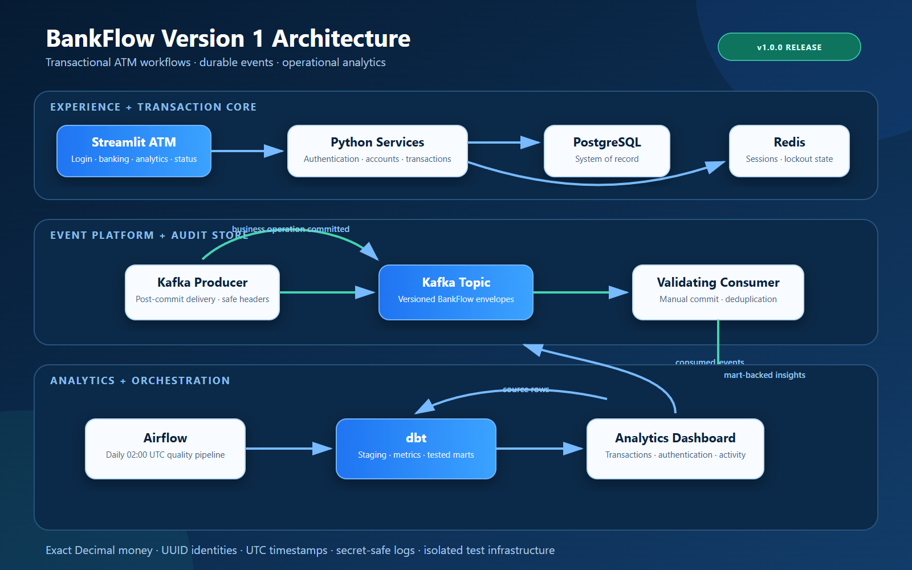

# BankFlow

**An educational ATM transaction and analytics platform using fictional data.**

BankFlow v1.0.0 evolves a command-line college assignment into a complete Python application and event-driven data platform. The release provides PostgreSQL persistence, Redis-backed authentication, exact-money banking workflows, a Streamlit ATM demo, versioned Kafka events, an idempotent validating consumer, tested dbt analytics marts, daily Airflow orchestration, and live analytics/platform-status pages.



Release evidence: [v1.0.0 notes](docs/RELEASE_NOTES_v1.0.0.md) · [portfolio screenshots](docs/V1_PORTFOLIO.md) · [Day 14 validation](docs/DAY14_VALIDATION.md)

## Quick start — Windows PowerShell

Use Python 3.14 (64-bit). From this repository directory:

```powershell
py -3.14 -m venv .venv
.\.venv\Scripts\python.exe -m pip install -r requirements-dev.txt -c requirements-lock-py314-windows.txt
.\.venv\Scripts\python.exe -m pip install -e .
.\.venv\Scripts\python.exe -m pip check
.\.venv\Scripts\python.exe scripts/check_environment.py
```

Calling the environment's Python directly avoids PowerShell activation-policy changes. Point your editor at `.venv/Scripts/python.exe`.

The lock file records the complete validated Windows/Python 3.14 dependency set. `requirements.txt` holds the direct application pins and is the package dependency source; `requirements-dev.txt` adds pytest and Ruff. Update the pins and lock together after validating a dependency change.

For another platform, create an environment with `python3.14 -m venv .venv`, use `.venv/bin/python -m pip install -r requirements-dev.txt`, then `.venv/bin/python -m pip install -e .`. That platform's dependency resolution and binary wheels must be validated separately; the Windows lock is not a cross-platform guarantee.

## Run the academic prototype

```powershell
.\.venv\Scripts\python.exe docs/original-college-project/atm_simulation.py
```

Fictional demo PIN: `2468`. Each run starts at $500. A $100 withdrawal leaves $400; three wrong PINs end the session; withdrawing $500 prints account closure. This archived script intentionally retains the original float-based validation bugs and process-local state. It is not the new transaction engine.

## Run the Streamlit demo

Start PostgreSQL and Redis in the dedicated `bankflow` container, apply migrations, seed the fictional account, and launch the app:

```powershell
.\.venv\Scripts\alembic.exe upgrade head
.\.venv\Scripts\python.exe scripts/seed_database.py
.\.venv\Scripts\streamlit.exe run app.py
```

Open [http://localhost:8501](http://localhost:8501) and use the displayed fictional PIN, `2468`. The app supports authentication, balance inquiry, withdrawal, deposit, transaction history, reset, and end-session workflows. Reset affects only the fixed fictional demo graph.

Run the operational event consumer in a second terminal after migrations:

```powershell
.\.venv\Scripts\python.exe consumers\transaction_consumer.py
```

It joins `bankflow-operational-v1`, validates version-1 envelopes, and writes deduplicated rows to `bankflow.consumed_events`. Press Ctrl+C for bounded graceful shutdown.

## Generate synthetic streaming events

Day 15 adds fictional, schema-valid transaction and authentication traffic for the Version 2 streaming pipeline. Validate a deterministic batch without Kafka:

```powershell
.\.venv\Scripts\python.exe scripts\transaction_generator.py --count 10000 --rate 0 --seed 15 --customers 1000 --atms 100 --dry-run
```

Publish a paced stream to the configured Kafka topic:

```powershell
.\.venv\Scripts\python.exe scripts\transaction_generator.py --count 1000 --rate 100 --seed 15
```

`--count` controls the exact event total, `--rate` sets the maximum event-start rate (`0` disables pacing), and `--seed` reproduces identifiers, event order, timestamps, amounts, and outcomes. Generated events use only fictional UUID subjects and include an `ATM-####` identifier. The tool validates every event through the released version-1 serializer before publishing.

## Run Spark Structured Streaming

Day 16 consumes the version-1 Kafka stream through the dedicated container's Spark 3.5.1 standalone cluster. The Kafka connector is supplied at submission time, checkpoints live in HDFS, and rejected records retain only safe transport metadata plus a value fingerprint.

```powershell
docker exec --user datalab bankflow bash -lc "cd /home/datalab/bankflow && /opt/spark/bin/spark-submit --master spark://localhost:7077 --packages org.apache.spark:spark-sql-kafka-0-10_2.12:3.5.1 streaming/bankflow_stream.py"
```

The default query starts at latest offsets only when creating its checkpoint. Restarting with the same HDFS checkpoint resumes from committed offsets. See the [streaming runbook](streaming/README.md) for replay, available-now validation, metrics, and invalid-record handling.

## Configuration and infrastructure

The Windows application connects to the dedicated `bankflow` container: PostgreSQL 5433, Redis 6380, and Kafka 9093. PostgreSQL, authenticated Redis, Kafka 3.7.1 metadata, and acknowledged Kafka delivery are verified. The dedicated broker advertises `host.docker.internal:9093` so host clients do not get redirected to its internal port.

On this workspace, application and test databases and ignored credentials are already provisioned. Run:

```powershell
.\.venv\Scripts\python.exe -m bankflow.database.health
.\.venv\Scripts\alembic.exe upgrade head
.\.venv\Scripts\alembic.exe current
.\.venv\Scripts\python.exe scripts/seed_database.py
```

For a fresh copy of this same lab, `scripts/provision_local_database.py` creates the two databases, restricted owner roles, and local environment files. Run it once with the dedicated container running. It deliberately refuses existing files or resources. For another PostgreSQL installation, create equivalent resources yourself, copy `.env.example` into ignored local files, and fill the connection settings. Never overwrite existing credentials to repeat setup.

Settings precedence is explicit arguments, process environment, dotenv, then defaults. Run commands from the repository root; the health command also accepts `--env-file PATH`. PostgreSQL and Redis credentials belong only in ignored local environment files. See the [environment guide](docs/ENVIRONMENT.md), [service reference](docs/SERVICES.md), and [authentication-state decision](docs/architecture/ADR-006-authentication-state.md).

## Project map

```text
BankFlow/
├── src/bankflow/             # importable package, separated by responsibility
│   ├── config/              # validated environment settings
│   ├── models/              # banking, audit, and consumed-event entities
│   ├── schemas/             # input and event contracts
│   ├── services/            # authentication, accounts, transactions
│   ├── repositories/        # typed lookups, balance updates, and transaction history
│   ├── database/            # engine, sessions, model base
│   ├── cache/               # Redis integration
│   ├── messaging/           # event factories plus Kafka producer and consumer
│   ├── ui/                  # Streamlit runtime and presentation helpers
│   └── utils/
├── pages/                   # ATM, analytics, and platform-status screens
├── consumers/               # operational event-consumer entry point
├── migrations/              # Alembic environment and versioned schema revisions
├── scripts/                 # environment, provisioning, and idempotent demo seed tools
├── tests/                   # unit tests and opt-in PostgreSQL tests
├── airflow/, dbt/           # V1 Airflow orchestration and dbt analytics
├── streaming/, spark/       # Spark ingestion plus planned Iceberg layer jobs
├── docs/                    # canonical planning and handoff documents
│   ├── analysis/            # dated pre-implementation review
│   └── original-college-project/ # unchanged source assets and checksums
└── graphify-out/            # project graph and extraction audit
```

## Documents and milestones

- [Product requirements](docs/PRODUCT_REQUIREMENTS.md)
- [Architecture](docs/ARCHITECTURE.md)
- [Visual design](docs/DESIGN.md)
- [Day-by-day tasks](docs/TASK.md)
- [Current project memory](docs/MEMORY.md)
- [Day 1 decisions](docs/architecture/ADR-001-foundation.md)
- [Day 2 validation](docs/DAY2_VALIDATION.md)
- [Day 3 validation](docs/DAY3_VALIDATION.md)
- [Day 3 domain model decision](docs/architecture/ADR-004-core-domain-model.md)
- [Day 4 validation](docs/DAY4_VALIDATION.md)
- [Day 4 repository decision](docs/architecture/ADR-005-repository-boundary.md)
- [Day 5 validation](docs/DAY5_VALIDATION.md)
- [Day 5 authentication-state decision](docs/architecture/ADR-006-authentication-state.md)
- [Day 6 validation](docs/DAY6_VALIDATION.md)
- [Day 6 transaction-engine decision](docs/architecture/ADR-007-transaction-engine.md)
- [Day 7 validation](docs/DAY7_VALIDATION.md)
- [Day 7 Streamlit-boundary decision](docs/architecture/ADR-008-streamlit-interface.md)
- [Day 8 validation](docs/DAY8_VALIDATION.md)
- [Event schema](docs/events/EVENT_SCHEMA.md)
- [Day 8 event-contract decision](docs/architecture/ADR-009-event-contract.md)
- [Day 9 validation](docs/DAY9_VALIDATION.md)
- [Day 9 Kafka producer decision](docs/architecture/ADR-010-kafka-producer.md)
- [Day 10 validation](docs/DAY10_VALIDATION.md)
- [Day 10 Kafka consumer decision](docs/architecture/ADR-011-kafka-consumer-event-store.md)
- [Day 11 validation](docs/DAY11_VALIDATION.md)
- [Day 11 dbt analytics decision](docs/architecture/ADR-012-dbt-analytics-layer.md)
- [dbt analytics runbook](dbt/README.md)
- [Day 12 validation](docs/DAY12_VALIDATION.md)
- [Day 12 Airflow runbook](airflow/README.md)
- [Day 12 orchestration decision](docs/architecture/ADR-014-airflow-analytics-orchestration.md)
- [Day 13 validation](docs/DAY13_VALIDATION.md)
- [Day 13 analytics/status decision](docs/architecture/ADR-013-analytics-and-status-ui.md)
- [Day 14 validation](docs/DAY14_VALIDATION.md)
- [Day 15 validation](docs/DAY15_VALIDATION.md)
- [Day 16 validation](docs/DAY16_VALIDATION.md)
- [Spark streaming runbook](streaming/README.md)
- [Day 16 Spark streaming decision](docs/architecture/ADR-015-spark-streaming-foundation.md)
- [Version 1 release notes](docs/RELEASE_NOTES_v1.0.0.md)
- [Version 1 portfolio and screenshots](docs/V1_PORTFOLIO.md)
- [Baseline analysis](docs/analysis/PROJECT_ANALYSIS.md)
- [Interactive project graph](graphify-out/graph.html) and [audit report](graphify-out/GRAPH_REPORT.md)

Delivery order: foundation → PostgreSQL persistence → authentication/Redis → transaction engine → Streamlit → Kafka producer/consumer → Airflow/dbt analytics → V1 acceptance → Spark/Iceberg V2.

## Development checks

```powershell
.\.venv\Scripts\python.exe -m pip check
.\.venv\Scripts\python.exe scripts/check_environment.py
.\.venv\Scripts\python.exe -m ruff check airflow src pages consumers scripts tests migrations
.\.venv\Scripts\python.exe -m ruff format --check airflow src pages consumers scripts tests migrations
```

Run unit tests without services, or opt into the dedicated test database:

```powershell
.\.venv\Scripts\python.exe -m pytest -q
$env:BANKFLOW_RUN_DB_TESTS='1'
.\.venv\Scripts\python.exe -m pytest -q
Remove-Item Env:BANKFLOW_RUN_DB_TESTS
```

Run the live Kafka acknowledgement and round-trip test alongside the other integrations with:

```powershell
$env:BANKFLOW_RUN_DB_TESTS='1'
$env:BANKFLOW_RUN_KAFKA_TESTS='1'
.\.venv\Scripts\python.exe -m pytest -q
Remove-Item Env:BANKFLOW_RUN_DB_TESTS
Remove-Item Env:BANKFLOW_RUN_KAFKA_TESTS
```

The live tests require `.env.test` with isolated PostgreSQL and Redis test resources. Kafka smoke tests use unique temporary topics, groups, and clients. The application suite has 117 service-free tests and all 146 pass with service opt-ins; the dbt project adds 67 source, model, and reconciliation tests. Spark runtime validation remains container-based because PySpark is intentionally not a Windows application dependency. See [Day 14 validation](docs/DAY14_VALIDATION.md) for Version 1 acceptance, [Day 15 validation](docs/DAY15_VALIDATION.md) for synthetic-stream evidence, and [Day 16 validation](docs/DAY16_VALIDATION.md) for Spark/Kafka/HDFS evidence.
