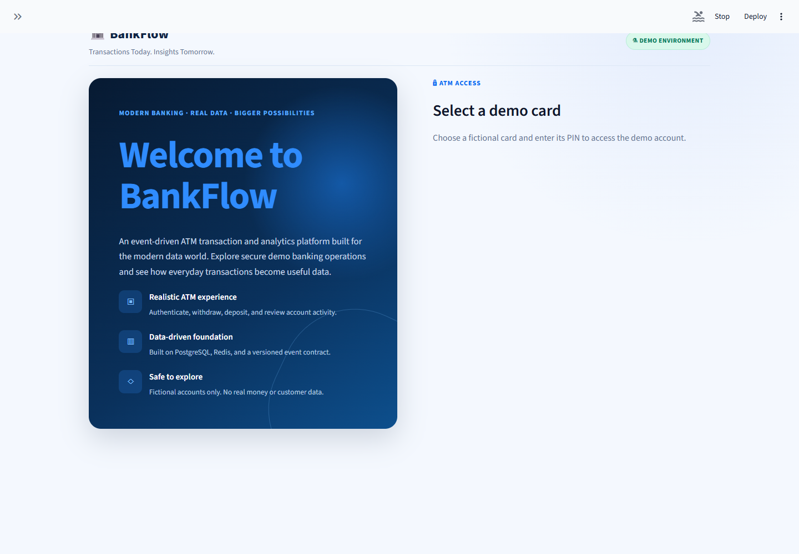
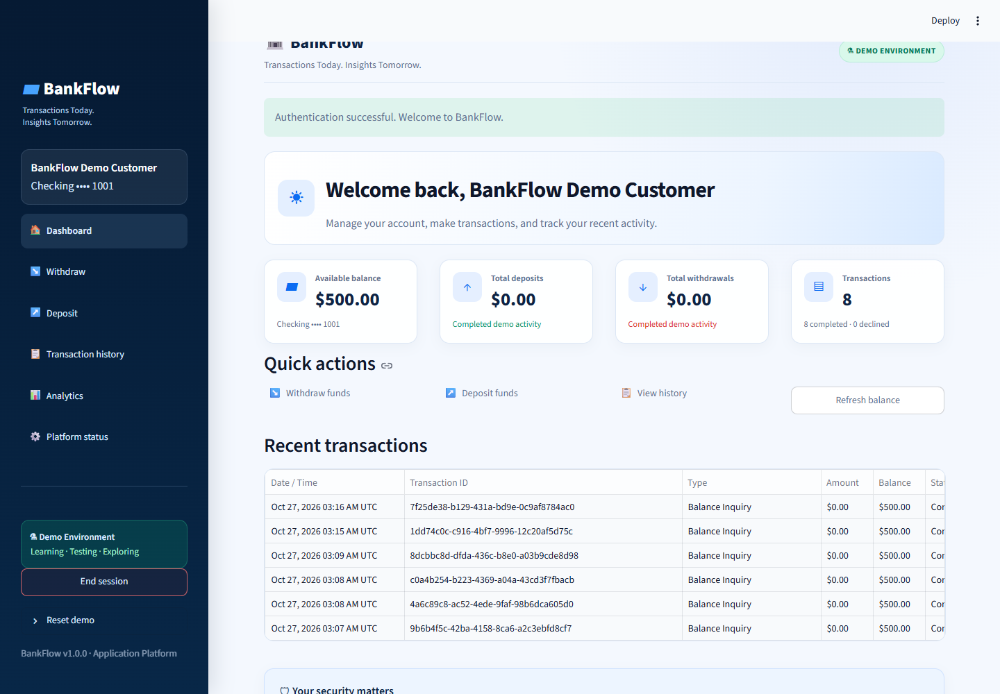
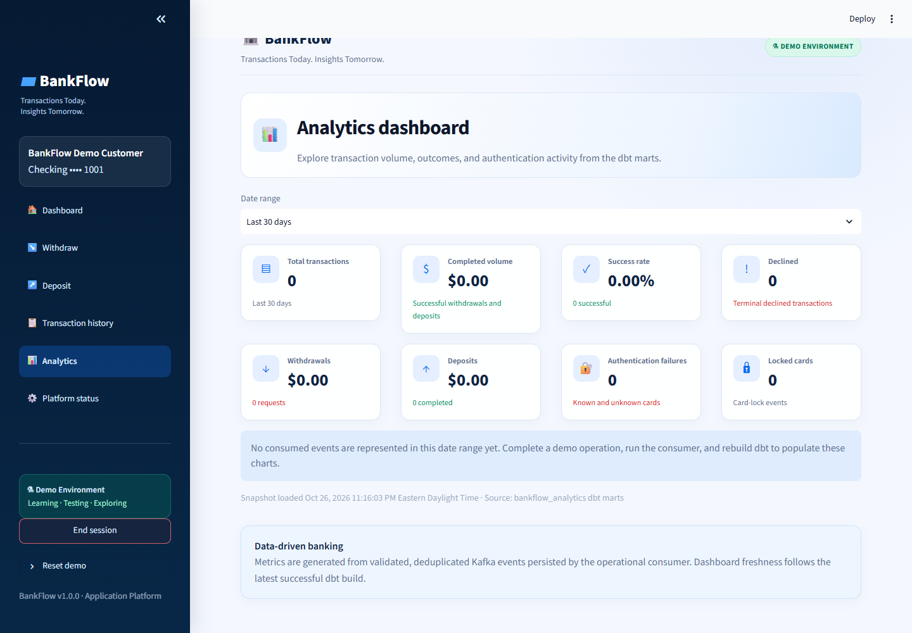
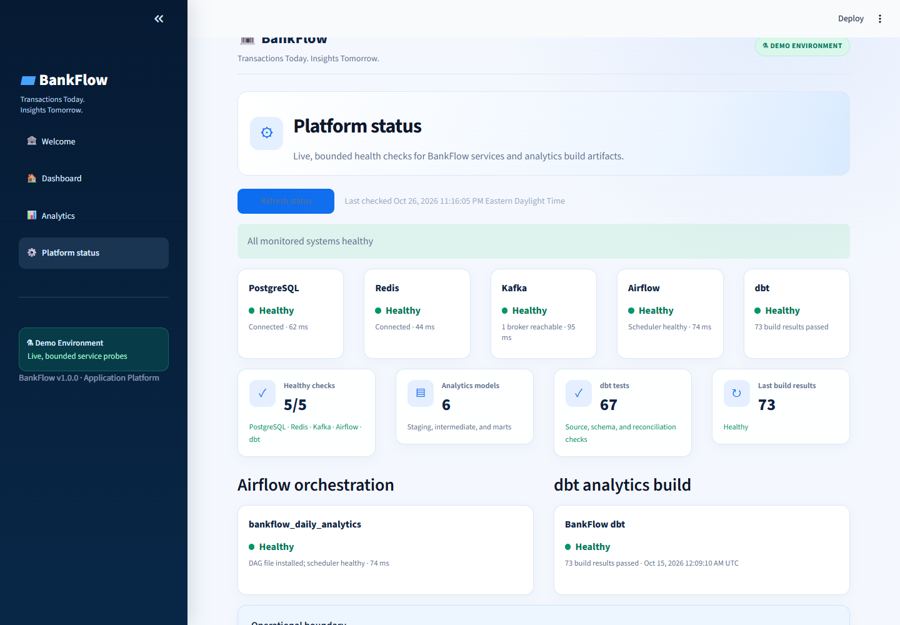

# BankFlow V1 Portfolio

BankFlow Version 1 is a fictional ATM transaction and operational-analytics platform. It combines an exact-money Python application, durable PostgreSQL persistence, Redis-backed authentication state, versioned Kafka events, an idempotent event store, tested dbt marts, and daily Airflow orchestration.

## Architecture

The editable source for this diagram is [bankflow-v1-architecture.svg](images/v1/bankflow-v1-architecture.svg).

## Demo screens

### Authentication

### Account dashboard

### Operational analytics

### Platform health

All screenshots were captured from the running Streamlit application against fictional demo data. The platform-status evidence shows healthy PostgreSQL, Redis, Kafka, Airflow, and dbt checks at release validation time.

